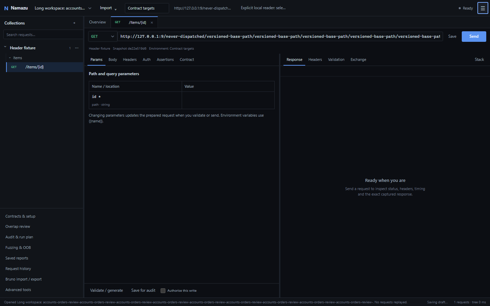
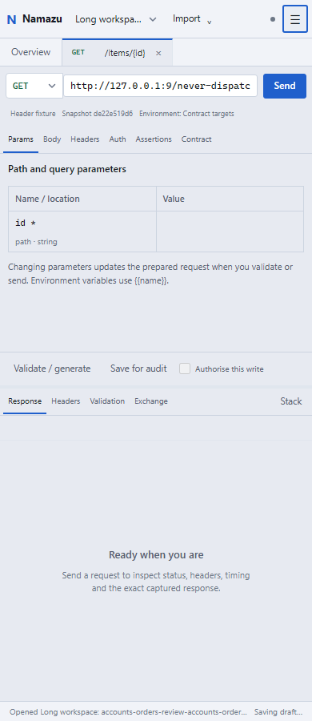
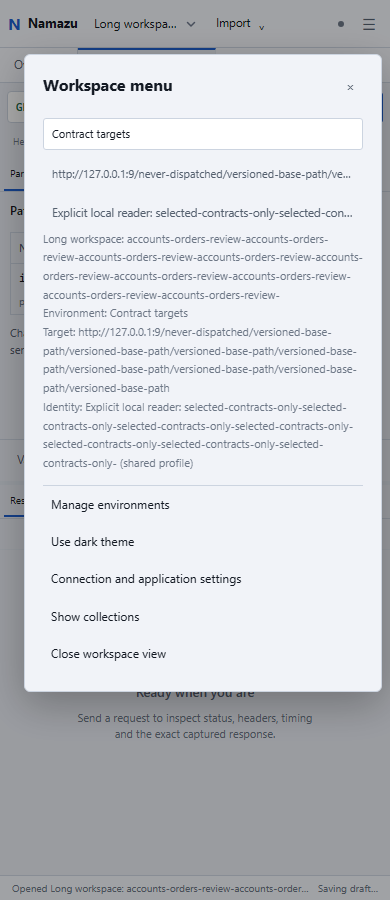
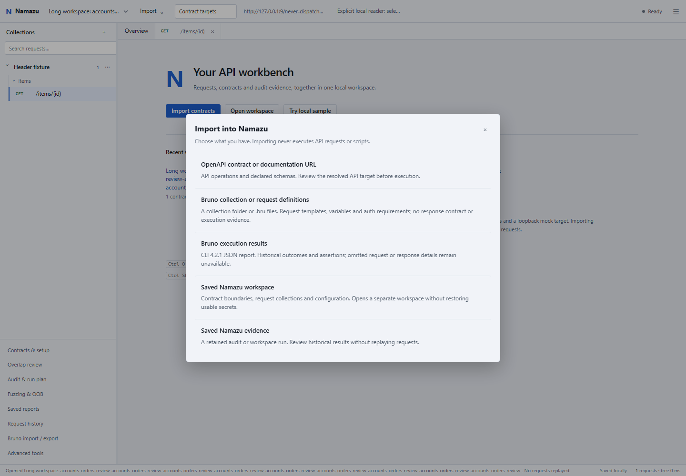
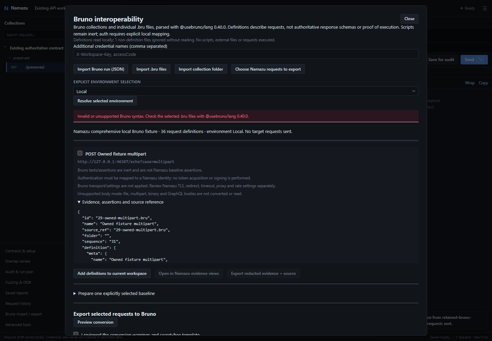
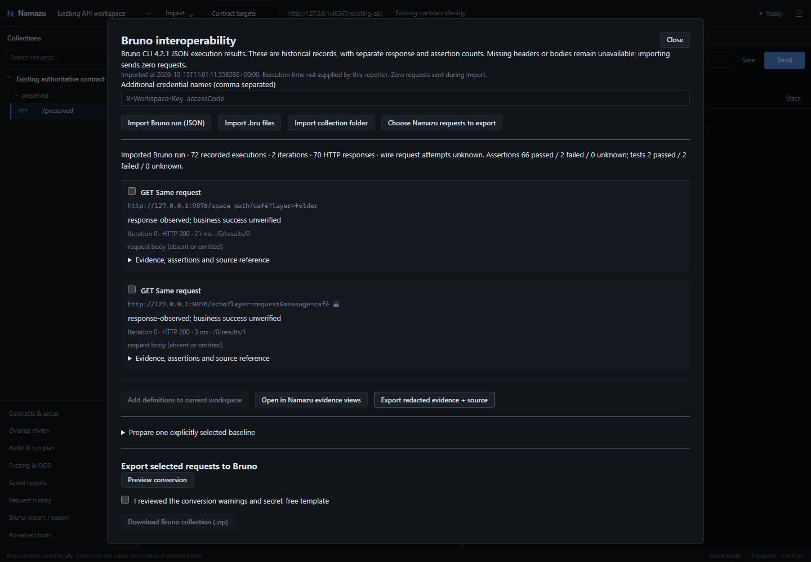
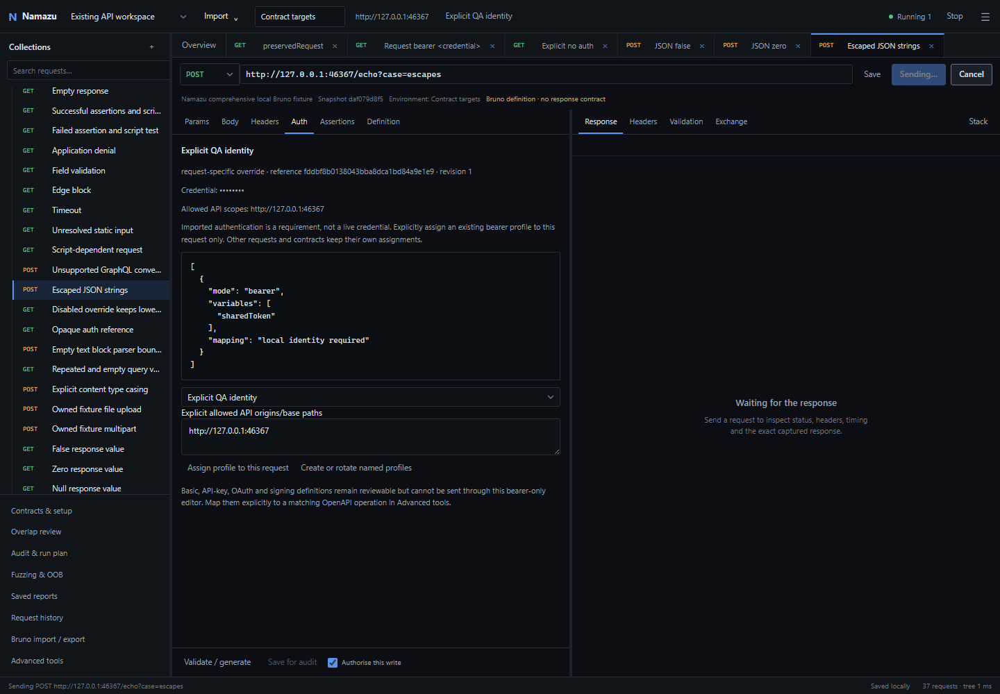
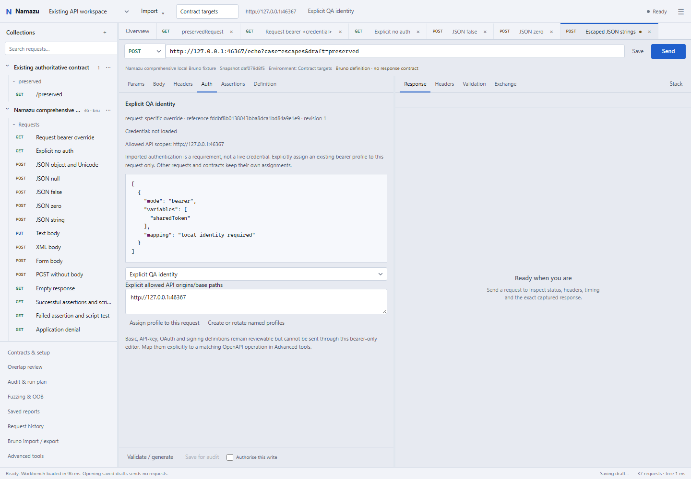

# Custom header and Bruno validation - 15 October 2026

This update uses a fresh portable folder, `dist/Namazu Desktop Header Bruno`,
and ZIP of the same name. The earlier `Namazu Desktop Windows` artifact remains
untouched. Validation below concerns this update and distinguishes source,
packaged renderer and native checks. Earlier screenshots and test totals are
not evidence for the new header.

## Implementation and retained workflows

The WinForms/WebView2 shell, shared JavaScript UI and Python engine are retained.
The separate native caption and File/Help strip are replaced with one compact
header. Namazu, workspace selection and Import stay left; the active environment,
target and identity occupy the middle. Execution state, Stop, menu and native
window commands remain accessible. At narrow widths the context moves into the
workspace menu, which exposes full values and theme/settings actions. Long
values truncate visually without losing their accessible names or tooltips.

The native application menu retains Import, workspace folder, screenshot, About
and Exit, plus Settings. Application close remains distinct from request-tab
close and closing the workspace view. The existing active-run close prompt,
bounded settling interval, owned-process cleanup and interrupted recovery remain.
Native controls are absent in browser mode.

WebView2's documented
[`IsNonClientRegionSupportEnabled`](https://learn.microsoft.com/en-us/dotnet/api/microsoft.web.webview2.core.corewebview2settings.isnonclientregionsupportenabled)
handles CSS drag/no-drag regions.
Standard WinForms resize/system-command styles remain; DWM theme attributes
match the UI where supported. The bridge accepts six fixed commands from the
exact local top document only. It accepts no paths, URLs, coordinates, shell
commands or arbitrary script. Window placement is versioned, DPI/monitor-fitted
and atomically saved with recovery backups. Failed persistence is surfaced in
the menu. Native drag, hit testing, snapping and display-scaling behavior still
need hands-on validation, as described below.
The HTML maximise control does not expose a Windows 11 hover snap-layout flyout;
Windows documents a separate `HTMAXBUTTON` requirement for that behavior.
The native system menu and Windows keyboard/drag snapping remain the supported
paths, with interaction validation still pending under the window-control stop.
See [Microsoft's custom-frame guidance](https://learn.microsoft.com/en-us/windows/win32/dwm/customframe)
and [snap-layout requirements](https://learn.microsoft.com/en-us/windows/apps/desktop/modernize/ui/apply-snap-layout-menu).

The unified Import chooser distinguishes OpenAPI/documentation URLs, Bruno
definitions, Bruno execution results, saved Namazu workspaces and historical
evidence. The existing parser and review dialog are reused. Added definitions
occupy their own nested request collection, with namespaced tabs and immutable
snapshot hashes. Per-request bearer assignments require an explicit local profile
and allowed API scopes. Collection import establishes no response contract,
business baseline, permission expectation or audit readiness. Existing OpenAPI
contracts, drafts, identities, audits, tools and saved evidence remain accessible.

## Bruno defects fixed

- Folder `auth: none` and `inherit` retain inherited authentication, matching
  CLI 4.2.1; a request's explicit `auth: none` remains unauthenticated unless
  the user separately assigns it an identity. Inherited header casing/precedence
  and disabled overrides follow that pinned CLI behavior.
- JSON `null`, booleans, numbers, strings, empty text, no body and raw form data
  remain distinct. Unsupported zero-byte-text export is rejected explicitly.
  Export reads ordinary/runner receipts from their retained request object,
  preserves body-presence/media metadata, and distinguishes semantic JSON values
  from raw report, definition and baseline text. JSON-looking literal strings
  are not silently converted into objects or reformatted when redaction is unnecessary.
- Structural auth metadata is no longer mistaken for token values during repeated
  sanitization. Credential aliases and echoes are masked without rewriting
  unrelated metadata or safe JSON strings.
- Credential-header references cannot be silently replaced by an incompatible
  bearer scheme. Ordinary sends do not follow redirects; imported credentials
  are never activated.
- Newly recognized secret values invalidate the definition snapshot and block
  redacted request content. Historical hashes remain attached to retained evidence.
- Failed previews preserve usable prior state; busy conversion actions are inert
  and visibly marked. Reimporting a definition snapshot is idempotent.
- Nested folders containing both direct requests and subfolders render once,
  preserving their expansion state. Same-named requests remain separate.
- Reports retain executions, iterations, HTTP responses and assertion namespaces
  separately. Missing bodies/headers and unknown wire-attempt counts stay explicit;
  repeated import does not accumulate extra executions.
  Contradictory skipped/response declarations retain the observed response and
  a warning; a skip flag does not erase captured evidence.

## Fixture provenance and validation boundary

Actual `@usebruno/cli@4.2.1` generated the full and omitted-evidence reports against
an owned loopback target. Both contain 36 definitions over two iterations: 72
logical executions, 70 recorded HTTP responses and two timeouts. Independent
mock ledgers record 72 network attempts per CLI run. Namazu does not infer that
wire count from report contents. The pinned official parser is
`@usebruno/lang@0.40.0`; the Windows package bundles Node 25.2.1.

The corpus includes nested folders, repeated names, inherited variables/auth,
per-request overrides, unresolved values, Unicode, spaces, scalar and escaped JSON,
text/XML/form bodies, empty values, assertions, uniform application denials,
validation responses, explicit edge pages and timeouts. Unsupported file,
multipart, GraphQL and script-dependent definitions remain inert and blocked.
Only the explicitly invoked real CLI fixture generator reads its owned upload
asset or executes its synthetic scripts. Namazu import does neither.

See [fixture provenance and reproduction](../tests/fixtures/bruno/comprehensive/README.md).
The separate real-CLI export/reimport run verifies 14 supported requests against
14 mock receipts, with zero import/export traffic. All endpoint activity in this
task used local fixtures or mock transports. No external API scans were run.

The source headless journey reports 15 checks and four explicitly sent mock
requests; import, export and restart checks sent none. It covers report and
definition errors, missing evidence, duplicate names, scoped identity assignment,
scalar bodies, reviewed export, retained drafts and narrow layouts. Its report is
`.local-reports/bruno-workbench-source-v8/report.json`. The later export-handoff
change has eight focused JavaScript-helper/official-parser regression cases;
those checks do not substitute for a packaged renderer or native-window test.

## Automated results

The final source suite passed **1,463 tests, one skipped**, in **249.47 seconds**.
The skipped test requires a packaged backend and is checked separately against
the rebuilt artifact. Ruff, all application JavaScript syntax checks, Python
compilation and the retained CLI help command passed. The suite emits one
existing Starlette/httpx deprecation warning. An initial restricted run failed
because it attempted to use inaccessible test/default storage; the recorded
passing run uses an explicit isolated `NAMAZU_STATE_DIR` and writable test paths.

The native Release build completes with **zero warnings and zero errors**.
**58 pure C# checks** pass for strict bridge source/argument validation, fixed
command dispatch policy, monitor/DPI placement calculations, atomic replacement,
prior-state backups, corrupt-state recovery backups and future-format protection.
Those tests create no GUI and do not validate native hit testing.

## Rebuilt package and packaged checks

The new executable is `dist/Namazu Desktop Header Bruno/Namazu.exe`. Extract the
complete `dist/Namazu Desktop Header Bruno.zip` before launching; the executable
depends on the adjacent bundled resources. The ZIP is **124,043,013 bytes**
(118.30 MiB), with SHA-256:

```text
4a84ebe1b339cf458b2cb18bf9d01b83d9802cfcd018e4e74c747d65b13a9220
```

Read-only verification matched **1,389 source inputs**, **1,798 artifact files**
and every ZIP member against the release manifest. The native shell and packaged
Python backend share the existing frontend and engine. No framework migration or
parallel import parser was introduced. The package retains Python, Node 25.2.1,
self-contained .NET and the official Bruno parser. Required build/runtime pins
are listed in [desktop-packaging.md](desktop-packaging.md).

The following checks used **this rebuilt backend and its bundled static resources**,
with child working directories containing spaces and a child `PATH` without
developer Python/Node. Chromium is a test harness, not a bundled application
runtime. No native window or operating-system file picker was driven.

| Check | Result and boundary |
|---|---|
| Packaged lifecycle | **9 passed** in 14.78 seconds: private session/host boundaries, startup errors, bundled parser/tool resources, owned-pipe shutdown, cancellation and interrupted recovery without replay. |
| Main request workspace | Passed; three explicit mock attempts, isolated schemas/drafts, large response/report inspection and zero restart replay. |
| Multi-contract workspace | Passed at 1440px and 390px; each run retained 14 unique attempts, three contract assessments and one reused assessment. Opening the saved report sent no requests. |
| Advanced workflows and detection | **21 checks passed** across the two groups; guided setup, permission planning, offline reassessment, migration, expert tools, local fuzz planning and callback evidence. Zero target requests. |
| Comprehensive Bruno import | **16 checks passed** in 19.02 seconds. Real CLI reports and definitions, malformed input, omitted evidence, inert HTML, per-request assignments, four explicit local Sends, export, duplicate import and restart. Existing OpenAPI hash/configuration, draft and identity assignment survived unchanged. |
| Header | **24 layout cases passed**: 1440/900/540/390px, dark/light themes and browser device scales 1/1.5/2. Checked long values, overflow, keyboard focus/Escape, five import destinations and ready/running/stopping/interrupted/disconnected states. Native controls correctly remained hidden. |

Bruno import, preview, export, cancellation of file selection, viewing and restart
produced zero target traffic. Explicit Sends were compared with independent mock
receipts for method, URL, headers and body. Session credentials and write consent
were not restored; identity references and draft context were. Secret scans of
the exercised persisted state passed. The journeys reported no external browser
requests, JavaScript page errors or measured narrow-view horizontal overflow.
Status presentation fixtures supplement the real backend cancellation checks;
they are not native window interaction tests.

Machine-readable local records are under `.local-reports/`:

- `header-bruno-release-verification.json`
- `header-bruno-isolated.log` and `header-bruno-packaged-host-final.log`
- `header-bruno-packaged-main/` (main and workspace)
- `header-bruno-packaged-advanced/` (advanced and detection)
- `header-bruno-packaged-bruno/report.json`
- `header-bruno-packaged-header/header-journey.json`

## Measured performance

These are individual local packaged-backend/headless-renderer measurements,
not native cold-start timings or claims about every machine. Source metrics:
`header-bruno-packaged-main/main/packaged-renderer-metrics.json` and the two
`packaged-journeys.json` records.

| Operation | Observed time |
|---|---:|
| Backend handshake across four journeys | 609–1,169 ms |
| Frontend workspace startup after page resources loaded | 39.10 ms |
| Request tab switch | 39.31 ms |
| Send and display a 1,500,030-byte local response | 939.62 ms |
| Import a 1,200-operation contract | 3,298.64 ms |
| Initial lazy collection-tree batch | 1 ms |
| Search and open in that collection | 51.13 ms |
| Import and render a 1,200-case historical report | 1,585.85 ms |
| Open a report group | 140.27 ms |

The initial tree measurement does not mean all 1,200 rows were rendered at once.
The frontend uses lazy batches and evidence pagination. Native launch, mixed-DPI
movement and OS file-dialog latency remain unmeasured.

## Screenshots

All images below are from the **rebuilt package's backend/resources in headless
Chromium**. They were visually inspected. They show actual application flows,
not mockups, but are **not native-window screenshots**. Desktop window controls
are deliberately absent without the native bridge. The 390px images exercise
the responsive browser layout below the native window's 540 logical-pixel minimum.

















## Reproduce the checks

Run from the repository root with the development dependencies described in
[desktop-packaging.md](desktop-packaging.md). The build intentionally refuses an
existing output folder; choose a fresh name when repeating it. The commands below
do not open or control a native window. Test harnesses use only owned loopback
targets and isolated state.

```powershell
$env:NAMAZU_STATE_DIR = Join-Path (Get-Location) '.local-reports/header-bruno-isolated-state'
.venv\Scripts\python.exe -m pytest -x -q --basetemp .test-header-bruno-isolated --override-ini cache_dir=.local-reports/header-bruno-pytest-cache
.venv\Scripts\python.exe -m ruff check .
Get-ChildItem namazu/static -Filter *.js | ForEach-Object { node --check $_.FullName; if ($LASTEXITCODE) { throw 'JavaScript syntax check failed' } }
.venv\Scripts\python.exe -m compileall -q namazu
.venv\Scripts\python.exe -m namazu --help

.\scripts\build-desktop.ps1 -OutputPath 'dist\Namazu Desktop Header Bruno'
$env:NAMAZU_PACKAGED_BACKEND = (Resolve-Path 'dist/Namazu Desktop Header Bruno/backend/Namazu.Backend.exe').Path
.venv\Scripts\python.exe -m pytest tests/test_desktop_host.py -q
python tests/desktop_packaged_ui.py --backend $env:NAMAZU_PACKAGED_BACKEND --output .local-reports/header-bruno-packaged-main --modes main workspace
python tests/desktop_packaged_ui.py --backend $env:NAMAZU_PACKAGED_BACKEND --output .local-reports/header-bruno-packaged-advanced --modes advanced detection
python tests/bruno_workbench_ui.py --backend $env:NAMAZU_PACKAGED_BACKEND --output .local-reports/header-bruno-packaged-bruno
python tests/desktop_header_ui.py --backend $env:NAMAZU_PACKAGED_BACKEND --output .local-reports/header-bruno-packaged-header
python tests/verify_desktop_release.py 'dist/Namazu Desktop Header Bruno' --output .local-reports/header-bruno-release-verification.json
```

The [capability checklist](desktop-capabilities.md) remains reconciled with the
delivered interface: existing contract/audit/evidence workflows are retained,
Bruno definitions have a separate collection destination, and expert settings,
replay, sequences and tools remain discoverable. Explicit limitations are listed
below; no native interaction check is inferred from the headless passes.

## Native validation restriction

The user's instruction to leave native window control stopped remains active.
No new native GUI launch, OS file/folder picker interaction, window dragging,
minimise/maximise/close interaction, snapping, mixed-DPI movement or native
screenshot is claimed for this build. The shell is compiled and its pure bridge
and placement policies are tested. Packaged-backend/headless renderer checks
are identified separately; browser device scale factors are not Windows DPI
validation. The old native screenshots belong to the old build.

The portable package remains unsigned Windows x64 and requires an installed
WebView2 Evergreen Runtime. macOS/Linux desktop packages are not claimed.
Bruno scripts/hooks, dynamic or external variables, auth signing/OAuth conversion,
binary/file/multipart/GraphQL bodies and unrecognized report formats require
manual conversion. A collection is never promoted to an OpenAPI response contract.
The ordinary collection editor supports only explicitly mapped bearer identities;
Basic, API-key and other credential-header schemes fail closed there. Existing
advanced tools require a separate manual request/auth setup for those cases.

These are application interoperability and isolation checks, not API security
coverage or evidence that an external API is secure.
