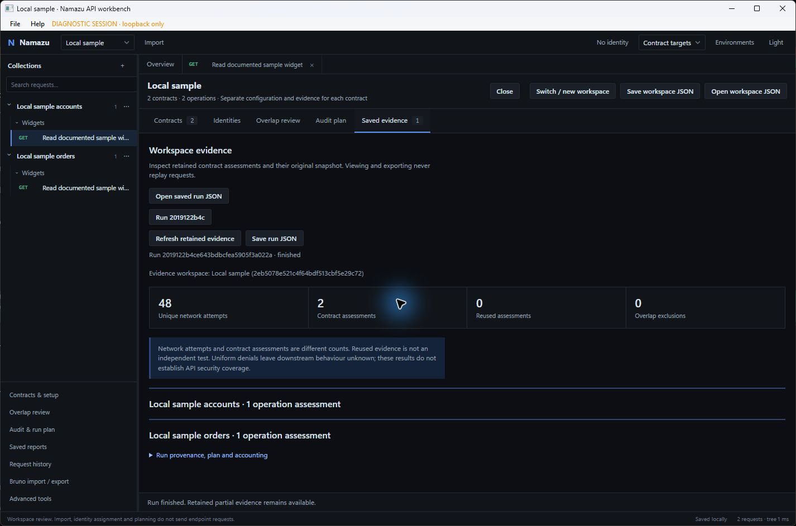
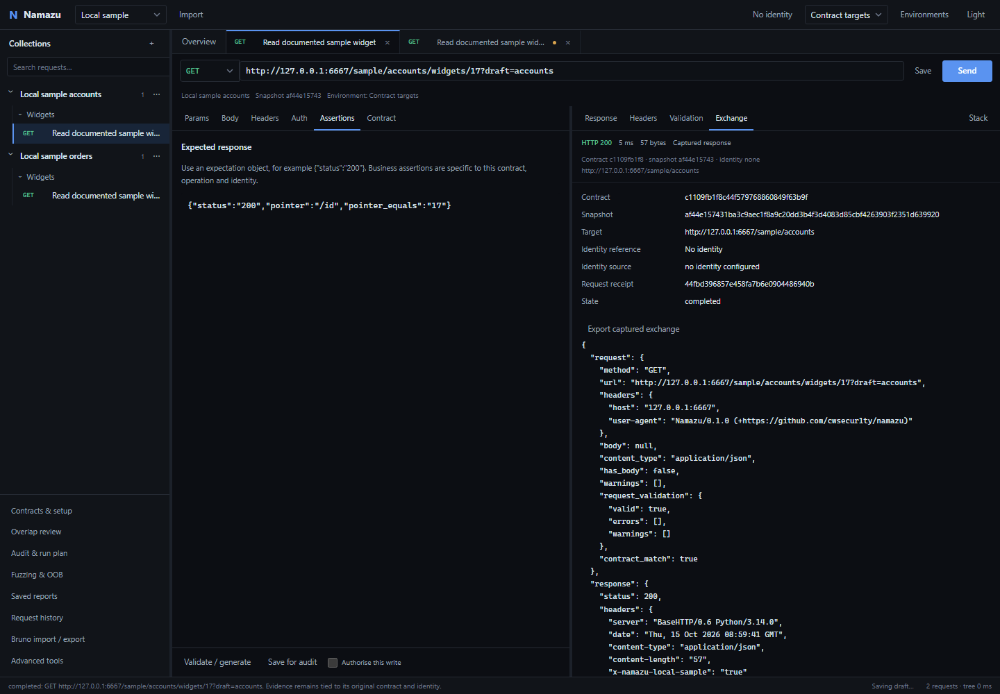

# Windows desktop validation - 15 October 2026

**Historical build record:** this page covers `Namazu Desktop Windows`, before
the custom header and expanded Bruno work. See
[header and Bruno validation](desktop-header-bruno-validation.md) for the rebuilt
artifact, fresh checks and the native-window restrictions that still apply.

The delivered portable application is `dist/Namazu Desktop Windows/Namazu.exe`.
Distribute the complete `dist/Namazu Desktop Windows.zip`, extract it, and open
`Namazu.exe`. The ZIP is 123,985,879 bytes (118.24 MiB), with SHA-256:

```text
e20decb1279ce3e4c81b18811224832ec2128bdbee759dd310677346f9b0e928
```

The package is unsigned Windows x64 and requires the installed WebView2 Evergreen
Runtime. Python, Node and the .NET application runtime are bundled. It needs no
development server or developer tools on the receiving machine. See
[packaging and reproducible build commands](desktop-packaging.md).

## Delivered workflows

The [capability and migration checklist](desktop-capabilities.md) maps the
existing workflows, backend implementations and tests to their desktop
destinations. The main workspace now provides independent request tabs,
contract collections, parameters/headers/body/authentication/assertions editors,
environments, ordinary Send/Cancel, response and exact exchange inspectors,
history, themes and persistent pane layouts. Contract import, scoped identity
assignment, overlap review, audit planning and saved evidence are dedicated
destinations. Existing advanced OAuth, readiness, schemas, runner, access
matrices, sequences, replay, connection settings and external tool controls
remain accessible through **Advanced tools**. Browser and CLI entry points remain
available; the desktop uses their testing engine and evidence model.

Multiple contracts keep stable identities and historical snapshots. Shared
bearer identities require explicit contract assignments and API base scopes;
overrides take precedence. Reviewed overlap reuse retains separate contract
assessments and a single count for each network attempt. The desktop also exposes
bounded native schema fuzzing and explicit Interactsh JSONL correlation. See
[detection behavior and limitations](detection-expansion.md).

## Automated results

All endpoint execution used loopback fixtures or mock transports. No external
API scans or public callback services were used.

| Check | Result |
|---|---|
| Complete Python regression suite | **1,386 passed, 1 skipped**, 200.30 seconds. The skip requires a packaged backend and passed in the separate package check. |
| Final targeted desktop/OOB loading regressions | **22 passed**. |
| Final packaged backend lifecycle tests | **9 passed**, 14.41 seconds. |
| Final packaged UI journeys | **4 groups passed**: request workspace, multi-contract audit, advanced compatibility, fuzzing/OOB. |
| Ruff, JavaScript syntax, Python compilation, CLI help | Passed. |
| Native .NET build and PowerShell build-script parsing | Passed; native compilation had zero warnings. |
| Package integrity | Verified 1,383 source inputs, 1,796 artifact files and every ZIP member against the built folder. |

The lifecycle tests launch the bundled backend from a separate directory whose
name contains spaces, with only Windows System32 on the child process PATH.
They exercise private loopback authentication, invalid startup, duplicate
workspace ownership, owner-pipe termination, shutdown, cancellation of a local
audit, interrupted-run recovery without replay, bundled Bruno parsing and
bundled Schemathesis startup. They do not constitute a native window automation
test.

The final UI checks use headless Chromium with the final package's backend and
static resources. They exercise first launch, tab/draft/environment separation,
ordinary sends, exact evidence, cancellation, inert HTML, large responses and
saved runs. At both 1440px and 390px the multi-contract journey imports three
usable contracts alongside one failed import, explicitly shares a bearer
identity, reviews overlap, runs a bounded local audit and opens its saved report.
Each produces **14 unique network attempts, three contract assessments and one
reused assessment**, with zero saved-report replay requests.

The advanced group passes 17 checks, including missing business-data guidance,
recorded successful controls, explicit two-identity permission expectations,
historical imports, offline reassessment, Bruno conversion, preference migration
and expert navigation. Its API fixture receives zero endpoint requests. Its
historical mixed report contains 141 recorded attempts and 135 responses; those
are imported evidence counts, not new traffic. The four OOB/fuzzing checks also
send zero endpoint requests. All groups report zero page errors and zero
external browser requests. The measured narrow setup/readiness/report/Bruno/OOB
panels have no horizontal overflow.

Regression tests additionally cover contract/schema/reference isolation,
conflicting declarations and overlapping templates, unassigned identity scopes,
redirect/reference credential boundaries, rotation and target invalidation,
distinct request contexts, independent assertions and write permissions,
budgets/429/cancellation, redaction, old exports, atomic writes, corrupt state,
disk-full simulation, concurrent saves, WAL migration, unsafe collection paths
and actual Windows DPAPI with inert credentials. Scans of the four final
journeys' persisted state and exports found neither their private desktop
capabilities nor their known fixture credentials. Screenshots use local fixture
data and masked credentials.

Machine-readable results are retained in:

- `.local-reports/packaged-windows-final/packaged-journeys.json`
- `.local-reports/packaged-windows-final/main/packaged-renderer-metrics.json`
- `.local-reports/packaged-windows-final/workspace/journeys.json`
- `.local-reports/packaged-windows-final/advanced/report.json`
- `.local-reports/packaged-windows-final/detection/report.json`
- `.local-reports/desktop-windows-release-verification.json`

## Manual native window checks and their boundary

Before native control was stopped, an earlier packaged QA candidate was opened
as a real Windows/WebView2 application. The local sample, request tabs, offline
audit plan, completed local audit and desktop/narrow layouts were inspected. The
native active-run close dialog appeared, defaulted to keeping the window open,
and **Cancel close** preserved the application. The local audit recorded 48
unique attempts and two contract assessments.

The user then instructed: **“Finish automated checks; leave window control
stopped.”** No subsequent native GUI control was performed. The final artifact's
bundled frontend/backend passed the automated checks above; its native window
was not manually reopened. The native **Stop work and close** button and a
complete final-window close/relaunch journey were not manually exercised.
Backend shutdown/crash/recovery were exercised automatically. Moving the window
between monitors with different Windows display scaling was not validated.

## Measured local performance

These are single-run measurements from the final bundled backend with headless
Chromium on this Windows development machine, not hardware-independent promises
or a native cold-window startup benchmark.

| Action | Measured duration |
|---|---:|
| Fresh backend readiness handshake across four isolated starts | 605–994 ms |
| Frontend workbench initialization in the main journey | 20.4 ms |
| Request tab switch | 42.43 ms |
| Send and display a 1,500,030-byte local response | 400.54 ms |
| Import a 1,200-operation contract | 2,329.91 ms |
| Bounded collection-tree render | 0.80 ms |
| Search that contract and open a matching operation | 50.96 ms |
| Import/render a saved report retaining 1,200 cases | 1,095.25 ms |
| Expand its first 100-case outcome group | 167.55 ms |

Collection rows and large case tables render in bounded pages. Response display
is paged separately from capture limits; truncation is visible. Full retained
evidence remains available in exports. Restoring the measured UI state replayed
zero requests.

## Screenshots

These are captures of the application with local fixtures, not design mockups.
The first image is the earlier native QA window; the remaining gallery captures
the final package's frontend/backend in headless Chromium. It does not imply
that the final native window was reopened.





| Flow | Capture |
|---|---|
| Restored tabs, environment and stacked light layout | [Light workspace](screenshots/restored-light.png) |
| Explicit shared identity scopes | [Identity assignments](screenshots/shared-identities.png) |
| Duplicate and different-version overlap review | [Overlap review](screenshots/overlap-review.png) |
| Reviewed scope, concurrency, ceilings and evidence reuse | [Audit plan](screenshots/audit-plan.png) |
| Unique attempts versus assessments at 390px | [Narrow results](screenshots/narrow-results.png) |
| Historical provenance and mixed response classification | [Offline reassessment](screenshots/offline-assessment.png) |
| Imported callback observations with separate accounting | [OOB evidence](screenshots/oob-evidence.png) |
| Earlier real native window at narrow width | [Native narrow audit](screenshots/native-audit-narrow.png) |

## Remaining limitations

- Windows x64 is the packaged target. macOS/Linux native builds are absent.
  The package is unsigned and portable, without an installer or updater.
- The final native-window and mixed-DPI checks above remain unperformed. An
  installed WebView2 Evergreen Runtime is required.
- Shared workspace profiles currently cover bearer tokens; other supported auth
  and OAuth controls remain in the integrated advanced workflow. Sharing a
  credential establishes neither access nor business success.
- Cross-document references require explicitly supplied companion documents.
  Overlap equivalence is conservative and reuses only an exact reviewed
  operation execution context; ambiguous path templates require review.
- Interactsh is a manual, bring-your-own-session JSONL workflow. There is no
  automatic registration, polling or vulnerability inference. Fuzzing uses the
  existing bounded campaigns; it is not an unconstrained fuzzing daemon.
- Nuclei and ZAP still require their separately installed tools. Schemathesis
  is bundled; the package check starts its help command, not a scan.
- Ended browser sessions' in-memory request history cannot be recovered.
  Browser preferences require explicit export from the original browser origin.
  Session-only credentials must be supplied again after restart.

These checks establish local application behavior and regression boundaries.
They do **not** establish API security coverage or the security of an external
target.

## Repeat the final package checks

Run from the repository using its development environment:

```powershell
.venv\Scripts\python.exe -m pytest -q
.venv\Scripts\python.exe -m ruff check .
Get-ChildItem namazu/static/*.js | ForEach-Object { node --check $_.FullName }
$env:NAMAZU_PACKAGED_BACKEND = (Resolve-Path 'dist/Namazu Desktop Windows/backend/Namazu.Backend.exe').Path
.venv\Scripts\python.exe -m pytest tests/test_desktop_host.py -q
python tests/desktop_packaged_ui.py --backend 'dist/Namazu Desktop Windows/backend/Namazu.Backend.exe' --output .local-reports/packaged-repeat --modes main workspace advanced detection
python tests/verify_desktop_release.py 'dist/Namazu Desktop Windows'
```

The UI harness requires Playwright's Chromium in the development environment.
It does not control an existing desktop window. Use a new output directory for
each run so previous evidence is retained.
